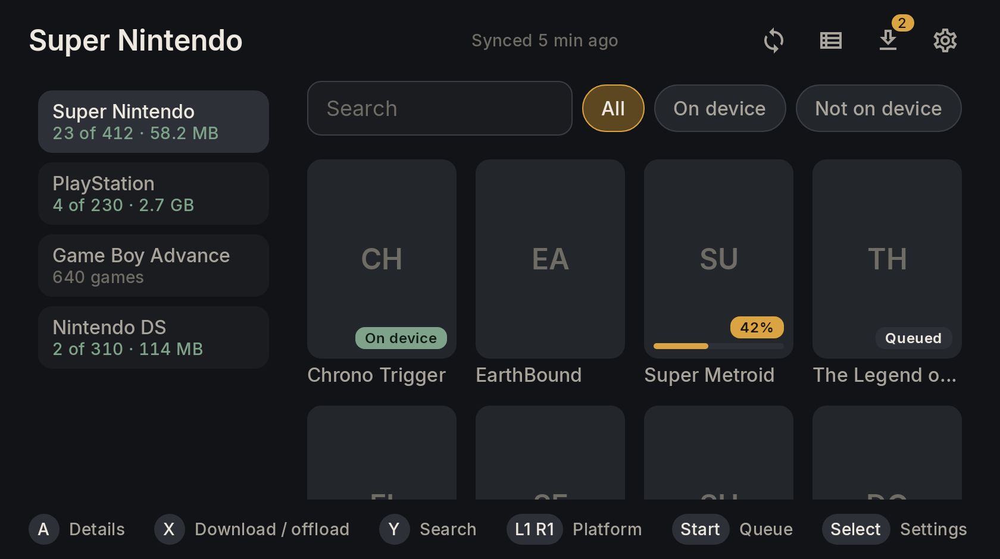

# Loom

[](https://github.com/davidsmonteiro/loom-romm/actions/workflows/ci.yml)

Loom is a small companion app for the [Cocoon](https://github.com/inssekt/CocoonFE) frontend on the AYN Thor. It copies games from your self-hosted [RomM](https://github.com/rommapp/romm) server into the folders Cocoon already scans, and removes them again when you need space. You still browse and play in Cocoon; Loom is the store you visit now and then.



Loom does not launch games, replace the home screen, or emulate anything. It does keep the saves of 3DS games played in Azahar, Switch games in Eden, DS games in melonDS and PSP games in PPSSPP in sync with RomM ([Save sync](#save-sync)); other emulators come later ([docs/ROADMAP.md](docs/ROADMAP.md)).

## What it does

- **Pairs without typing a token.** Loom shows a QR code and an 8-character code. You approve it on your phone in RomM's web UI. RomM's own pair code and a pasted token also work.
- **Keeps an offline copy of the catalog.** After the first sync you can browse every platform, with covers, with no network.
  - Later syncs only fetch what changed. Deleted games are detected by comparing ID lists.
  - When RomM can't be reached, the library's header says **Offline · showing your saved library** above when it last synced. Loom knows from the requests it makes anyway (syncs, covers, downloads, saves), and asks RomM's heartbeat again when Loom comes to the front, when a network comes or goes (Wi-Fi, Tailscale), and, while RomM is out of reach and Loom is in front, now and then (30 seconds apart at first, then less often, at most every 5 minutes). The note goes as soon as RomM answers.
  - Loom syncs by itself every 12 hours, in the background, while the Thor is online and its battery isn't low. This only updates the library: games are downloaded only when you ask. If RomM can't be reached at the time (away from home, or with Tailscale off), Loom tries again a few times over the next few minutes, then waits for the next one without showing an error.
  - In **Settings → Library sync** you can sync every 6 or 24 hours instead, turn it off, or keep it to Wi-Fi (not mobile data or a phone's hotspot). **Only on Wi-Fi** holds back new covers too; covers already on the Thor still show. That section also shows when the library last synced, and has **Full resync**, which fetches the whole catalog again rather than only what changed.
  - After a sync, Loom fetches in the background every cover it doesn't have yet, from RomM's small cover art: about 0.1 MB each to fetch (roughly 2 GB for 20,000 covers, the first time) and 15 KB to keep (roughly 300 MB). RomM's small covers are a little narrower than a card on the Thor, so they look slightly soft.
  - A cover you look at is made sharp in the background, from RomM's large cover art, at the size the library draws it (297×396 px, a focused card): about 0.5 MB to fetch and 20 KB to keep, only for the covers you look at. Until then the small one is shown. Covers kept by an earlier Loom are sharpened the same way when you look at them.
  - Covers live in Loom's cache, so Android may trim them when storage runs low; the next sync fetches them again.
- **Puts each game in the right system folder.** For example `ROMs/snes/`, `ROMs/gc/` or `ROMs/n3ds/`, from a mapping you can edit. It defaults to Cocoon's folder names.
- **Never shows Cocoon a half-written file.**
  - Downloads go to a hidden staging folder on the same SD card.
  - Every file is checked against RomM's checksums.
  - The finished game appears with a single rename.
- **Survives interruptions.** Pausing, the screen turning off, the app being killed, the SD card being pulled, or changing the server address in Settings: downloads resume where they stopped.
- **Offloads.** Removing a game frees the space and keeps it in the library, so it can come back with one press.
- **Receives games sent from RomM.** With RomM 5.4, **Install on device** in RomM's web UI (on your phone, say) lists the Thor. A game sent there lands in Loom's queue, marked **From RomM**, and downloads like one you picked, into the same folder; RomM shows "Added to downloads" once it's queued, "Already installed" if it's on the card, or "Failed" with Loom's reason.
  - While Loom is open the game arrives within seconds; otherwise within about 15 minutes, or when Loom next opens. Nothing runs while the Thor sleeps, and RomM shows the Thor online only for a while after Loom last asked.
  - When Loom would ask which folder the platform's games go in, the game waits in the queue instead, with a notification: press A on it there.
  - **Receive games sent from RomM** in Settings → Downloads turns it off, and RomM stops offering the Thor. That line also says why games can't come when they can't, with **Pair again** beside it when only pairing again would fix it.
- **Syncs 3DS, Switch, DS and PSP saves with RomM.** Changed saves go up by themselves; RomM's come down only when you ask, after a backup; when both changed, Loom asks which to keep.

## Requirements

| | |
|---|---|
| RomM | 5.0 or newer. Built and tested against **5.4.0**. Sending games from RomM's web UI needs 5.4. |
| Device | Android 11+ (minSdk 30). Designed for the AYN Thor's top screen, which runs Android 13. |
| Permissions | **All files access**, to write into the folders Cocoon scans. Loom is sideloaded, so Play policy doesn't apply. Also notifications, and an optional battery-optimisation exemption so downloads restart in the background. |

## Install

Get `loom-<version>.apk` from [Releases](https://github.com/davidsmonteiro/loom-romm/releases), or let [Obtainium](https://github.com/ImranR98/Obtainium) install it and keep it up to date: **Add app**, paste `https://github.com/davidsmonteiro/loom-romm`, then **Add** and install.

If you built and installed Loom yourself, uninstall that copy first. Android won't update it with a release signed by a different key, and Obtainium may report it as already up to date.

Releases are signed with this certificate:

```
SHA-256: 01:CD:53:46:8D:2A:18:CE:EF:36:60:89:D8:C0:BF:D6:9D:B6:BD:2B:6B:BE:9D:1E:8E:2C:03:F9:30:81:D2:27
```

To check an APK: `apksigner verify --print-certs loom-<version>.apk`.

To open Loom from Cocoon, add it from Cocoon's app drawer.

## Build from source

You need JDK 17 and the Android SDK with `platforms;android-37.0` and `build-tools;37.0.0`:

```sh
sdkmanager "platforms;android-37.0" "build-tools;37.0.0"
./gradlew assembleDebug
adb install -r app/build/outputs/apk/debug/app-debug.apk
```

Release builds are minified with R8 (`./gradlew assembleRelease`). They're signed with your debug key unless there's a `keystore.properties` file in the repo root (it's gitignored):

```properties
storeFile=/path/to/loom.jks
storePassword=…
keyAlias=loom
keyPassword=…
```

With it, release builds are signed with that key. Signed with the key behind this repo's releases, they install over a published release in place, keeping pairing and data. Debug builds always use the debug key: a debuggable build signed with the release key could replace a release and expose its data. Without the file, the release build is signed with the debug key, so it installs over a debug build to test the minified app.

Android only updates an app signed with the same key. Moving between a release from this repo and your own build, or between two keys, therefore means uninstalling first. That wipes Loom's data: you pair again (then revoke the old client token in RomM's web UI) and Loom picks up the games already on the card when it syncs.

## First run

1. **Server address.** One address, whichever reaches RomM from the Thor:
   - a local one, e.g. `192.168.1.10:8080`;
   - a Tailscale IP or MagicDNS name, e.g. `100.64.0.5:8080`;
   - or your domain, e.g. `romm.example.org`.

   Without a scheme, LAN and Tailscale hosts try `http://` first and everything else tries `https://` first. Change it any time in Settings → Server & pairing; queued downloads continue from the new address.
2. **Pair.** Scan the QR code with your phone and approve "Loom" in RomM.
   - Alternatively, create an API token in RomM's web UI and use **Pair device** to get an 8-character code, or paste a token.
   - Loom asks for these scopes: `me.read platforms.read roms.read assets.read assets.write devices.read devices.write`. The asset and device scopes are for save sync.
3. **All files access.** Grant it in Android settings, then press B to come back.
4. **ROMs folder.** Pick the folder that holds your system folders.
   - Loom suggests `<SD card>/ROMs`.
   - The folder browser highlights folders whose names match Cocoon's systems.
5. **Background downloads.** Allow notifications and exempt Loom from battery optimisation.
6. **First sync.**

## How games land on disk

Each game becomes exactly **one entry** in its system folder, so it can appear in a single step and Cocoon shows it once:

| On RomM | On the SD card |
|---|---|
| One file (`.sfc`, `.iso`, `.chd`, `.nsp`…) | `ROMs/snes/Chrono Trigger (USA).sfc` |
| A folder with one game file | The file, taken out of the folder |
| Several discs, or a disc split into tracks (cue/bin, gdi) | `ROMs/psx/Final Fantasy VII (USA).m3u/`, containing the discs and a generated `Final Fantasy VII (USA).m3u` (the ES-DE "directory as file" layout Cocoon supports) |
| A zip/7z on a platform set to **unpack** (disc systems, DS, 3DS, Switch…) | Unpacked, then laid out as above. A single file inside takes the game's name: `ROMs/ps2/Super Bust-A-Move (USA).bin`, not `SLUS-20115 (1.00).bin` |
| A zip on a platform set to **keep** (arcade, most cartridge systems) | The archive as it is |
| Anything else with several files (PS3, Wii U…) | `ROMs/ps3/Game (USA)/`, mirroring RomM. Cocoon needs **Scan Subfolders** on to see these. |

Behind the scenes:

- **Staging.** Downloads are written to `<SD card>/.loom-staging/` as `*.part` files, outside the ROMs folder, so Cocoon's folder watcher never sees them. They resume with HTTP Range after any interruption.
- **Verification.**
  - Plain files are checked against RomM's SHA-1, MD5 or CRC32.
  - Zips and 7z files are checked member by member, because RomM hashes their unpacked contents ([ADR 0003](docs/adr/0003-verify-archives-by-member-hashes.md)).
  - Platforms RomM never hashes (Switch, Wii U, PS3…) are checked by size.
- **Name clashes.**
  - A file that's already on the card under the same name is never overwritten: the download stops with an explanation.
  - Two RomM games that would get the same name are told apart with a ` (romm-<id>)` suffix.
- **Games already on the card.** Games already in the place Loom would put them are picked up as "On device" without downloading: games you copied yourself, and Loom's own after a reinstall.
  - A file must have RomM's size. A game Loom unpacked is looked for under the name Loom gave it (`Super Bust-A-Move (USA).bin`), with the size RomM lists for the file inside the archive.
  - A folder (`Name.m3u/` or `Name/`) is matched by its name.
  - RomM sometimes lists nothing inside an archive. On platforms set to unpack, Loom then matches the game by name alone: `Pokemon X (Europe).3ds` for `Pokemon X (Europe).zip`. That only happens when exactly one file or folder in the system folder has that name and isn't already another game's, and the game's details say it was matched by name only.
    - A file or folder counts only if it's at least half the archive's size: a save or a cover named after the game is never taken for it, and doesn't stop the game being found. Saves, save states and cheats (`.sav`, `.srm`, `.state`…), images and documents never count, whatever their size.

## Preparing your RomM library

Loom installs what RomM serves, so a few things are best fixed in the library itself:
- **Multi-disc games:** keep each one in its own folder in RomM (`roms/psx/Final Fantasy IX/` holding the discs). RomM then serves it as one game and Loom installs it as one `Name.m3u/` entry. Loose `Game (Disc 1).chd`, `Game (Disc 2).chd` files are listed by RomM, and installed, as separate games.
- **Sidecar files** such as PlayStation LibCrypt `.sbi` files: keep them in the game's folder next to its disc. Loose in the platform folder, RomM lists each as a game of its own, and the disc gets installed without it.

## Platform folders

Defaults map RomM's platform slugs to Cocoon's folder names. For example, `ngc → gc`, `3ds → n3ds`, `sms → mastersystem`, `dc → dreamcast`. RomM's single `arcade` slug is split by its server folder into `mame`, `fbneo`, `naomi` and `atomiswave`. The defaults are in [`core-storage/src/main/resources/platform-mapping.default.json`](core-storage/src/main/resources/platform-mapping.default.json); tests check them against RomM 5.3.1's slug list and Cocoon's `platforms/index.json`.

In **Settings → Platform folders** you can change each platform's:
- folder
- archive handling (keep or unpack)
- multi-disc layout (`Game.m3u` folder or plain folder)
- which RomM file categories to download (game only by default; add `update` and `dlc` for Switch, for example)

**Export** writes the full mapping to `Download/loom-mapping.json`; **Import** reads it back. Platforms Loom has no default for use the server's folder name and are marked **Check**.

Cocoon can read any folder for a system, so the folder name alone doesn't tell Loom which one Cocoon uses. Each platform therefore lists the other names its folder often has (ES-DE's, among others: `arcade`, `mame`, `fbneo` and `fba` for arcade; `genesis` and `megadrive`). At a platform's first download Loom looks at the card:
- one of those folders holds games, or only one exists: Loom uses it and says so;
- none exists: Loom creates the default;
- several exist and it can't tell (ES-DE's template has them all, empty): Loom asks, with the likeliest folder focused, or **Another folder…** for any folder in the ROMs folder. A game sent from RomM waits in the queue for that answer, saying **Choose its folder**, and the queue opens on it, ahead of the other downloads and of any saves to settle; A on it asks, and "Pause all" leaves it waiting.

A `saves` folder in the ROMs folder (for emulators' saves, such as `ROMs/saves/Eden`) is never taken for a system folder: Loom doesn't look for games in it, offer it, mark it as a system when you browse, accept it as a platform's folder, or offload anything in it.

Either way the choice is remembered for that platform; change it in Settings → Platform folders. Games already downloaded stay where they are. Under the folder field, the editor lists the platform's other usual folders and what the card holds of each, for example `mame (52 games), fbneo (no games), fba (not on the card)`. A platform without other usual folders gets Cocoon folder names that start with the same letter instead.

## Controls

| Button | Library | Queue | Everywhere |
|---|---|---|---|
| D-pad | Move | Move | Move |
| A | Game details | Choose a save or a folder, restore a save, or pause / resume / retry a download | Select |
| B | | | Back (closes dialogs) |
| X | Download, or offload (asks first) | Cancel (asks first) | |
| Y | Search | | |
| L1 / R1 | Previous / next platform | | |
| Start | Open the queue | | |
| Select | Settings | | |
| R3 | | | Hide or bring back the second screen's panel |

With two screens, as on the Thor, the other one shows the game you're on, or the download or save conflict in the queue, while Loom is in front. It only shows: the pad stays with Loom, and tapping that screen does nothing. To use an app open on that screen, press R3: the panel goes, and stays gone, even once you've used that app and come back to Loom, until you press R3 again or next open Loom. Settings → Controls & screens → **Use the second screen** turns the panel off altogether.

In a save conflict's choice, B is **Skip**. For Nintendo-layout pads, use Settings → Controls & screens → **Swap A and B**. Touch works too, and the first button press after a tap still acts (it doesn't just bring the focus ring back), except X, which only brings focus back so it never downloads a game you didn't pick. Loom runs full screen; swipe from an edge to see the system bars.

## Save sync

Loom keeps the saves of the 3DS games (in Azahar), Switch games (in Eden), DS games (in melonDS) and PSP games (in PPSSPP) it installed, or found on the card, in sync with RomM, so a game can carry on on another device (Argosy, RomM's web player) and a save is never lost on the Thor.

**What syncs.** A game's own save, not save states or 3DS extra data (extdata), in RomM's `autosave` slot, uploaded as Argosy uploads it so either app's save restores in the other:
- **3DS (Azahar).** Loom finds the save from the title ID in the cartridge image (`.3ds`, `.cci`), or the one RomM read, in Azahar's folder: on the Thor that's inside `ROMs/n3ds`, at `sdmc/Nintendo 3DS/…/title/00040000/<title>/data/`. The `data/` folder is what travels. If Azahar keeps its data elsewhere, choose its folder in **Settings → Saves**.
- **Switch (Eden).** Eden keeps its saves in `Android/data`, where Loom can't read them, so move Eden's save folder to the SD card first, to `ROMs/saves/Eden` (Loom looks there; anywhere else, choose it in **Settings → Saves**). A game's save is `user/save/0000000000000000/<profile>/<title ID>/`, and that title ID folder is what travels, under its own name. With several Eden profiles, Settings → Saves asks whose saves to sync.
- **DS (melonDS).** melonDS keeps one `.sav` per game, named after the ROM file. Out of the box it saves next to the ROM, or in `Android/data` for a game it hasn't scanned yet, so set it to keep saves on the SD card: in melonDS, Settings → **Save Files**, turn off **Save next to ROM file**, then set **Save file directory** to `ROMs/saves/melonDS` (create the folder in the picker). Loom looks there; anywhere else, choose it in **Settings → Saves**. The `.sav` travels as it is, not zipped, as Argosy and RomM's web player keep it. The empty `.sav` melonDS makes when a game first runs is no save. DSiWare keeps its save inside melonDS's DSi NAND and isn't synced, and two installed games whose saves would have one name (a DS and a DSi copy of a game, say) sync neither; a DSiWare title doesn't count, having no `.sav`.
- **PSP (PPSSPP).** In PPSSPP, Settings → System → **Memory Stick folder** → **Create or Choose a PSP folder**, and pick `ROMs/saves/PPSSPP` (create it in the picker; don't call it `PSP`). Loom looks there once PPSSPP has used it; anywhere else, choose it in **Settings → Saves**. PPSSPP keeps saves in its `PSP/SAVEDATA`, one folder per save named after the game's disc ID (`ULUS10064DATA00`, `ULUS10064SETTINGS`), and all of a game's folders travel together, each under its own name. Some games install data there too, a copy of the disc rather than progress: it stays out, by the same rule as Argosy's, and a restore leaves it alone.

**Switch title IDs and prod.keys.** RomM can't tell Loom a Switch game's title ID: it is in the game's encrypted NCA headers, and RomM doesn't have the key. So Loom reads it itself from the game's `.xci` or `.nsp` (`.xcz`, `.nsz` too), a few kilobytes of it, with the `header_key` in your own `prod.keys` (dumped from your Switch). Put `prod.keys` in the ROMs folder (or its `switch` folder). Loom reads the key only when a game's title ID isn't known yet, keeps it in memory just for that read, and then drops it (Loom zeroes its own copy; the copies Android's crypto library makes go when its memory is reclaimed): it never stores, logs or uploads the key, and it never leaves the Thor. The title ID it read is remembered with the image's size and time, so later syncs don't read the image again. Without a usable `prod.keys`, a Switch game's details offer **Choose save folder**: Eden's save folders (no other game's), newest first with when each changed, and Loom remembers your pick (**Change save folder** picks again). Once a `prod.keys` can read the game, Loom checks the pick against it, and a pick the game's file contradicts stops that game's sync until you choose again. An update or DLC keeps no save of its own, and two games with the same save folder sync neither.

**PSP disc IDs.** RomM tells Loom a PSP game's disc ID when it read one as it scanned the game (from an ISO, CSO or CHD). Otherwise Loom reads it from the game's `.iso`, `.cso` or `.pbp`, a few kilobytes of it, and remembers it with the file's size and time. When neither can tell (a `.chd` RomM didn't read), RomM and the game's file disagree, or the file names two IDs, the game's details offer **Choose save folder**: the disc IDs PPSSPP's save folders start with (no other game's), newest first, with how many folders each has and when they changed. Loom remembers your pick (**Change save folder** picks again), until RomM or the game's file names another disc, which asks again. Two games with one disc ID sync neither.

**A Switch save in two folders.** A game Eden saves per console keeps its save in the all-zeros (console-wide) folder beside the profiles. If Eden later writes one for it in the profile's folder too, the two hold different saves, and Loom won't switch between them by itself: that game's sync stops, and its details say "in two Eden folders" and offer **Choose save folder**, with both folders, when each changed and what it holds. Loom syncs the one you pick from then on (**Change save folder** picks again) and leaves the other as it is: nothing is moved or deleted. Picking the folder Loom synced carries on as before; picking the other compares its save with RomM's as a first sync would, so two different saves become a conflict to settle, and keeping RomM's backs up that folder's save first.

**Uploads happen by themselves.** Every 15 minutes, when Loom opens and when the SD card is mounted, Loom uploads the saves that changed on the Thor. It waits until a save has been left alone for a minute and reads the same twice a few seconds apart, so it never sends one the emulator is still writing. **Upload saves automatically** in Settings → Saves turns this off; **Upload save** in a game's details and `PUSH_SAVES` still work. With it off, Loom looks at saves only when asked (opening a game's details, Upload save, `PUSH_SAVES`, `PULL_SAVES`), so it doesn't tell you about newer saves on RomM or new conflicts either. An upload never deletes anything: RomM keeps the older versions (ten per game). Loom doesn't upload a save larger than it would restore (64 MB for a 3DS, DS or PSP game, 256 MB for a Switch game), so every save it sends can come back; the game's details say why it isn't synced. A PSP game's folders that large most likely hold data the game installed.

**Saves from RomM wait for you.** Loom can't tell whether the emulator is still running, and an emulator left in the background writes over a restored save the next time the game saves. So RomM's save replaces the Thor's only when you ask: **Restore server save** in the game's details, or A on the game in the queue (with automatic upload on, a notification says when RomM has a newer save). Loom asks you to close the emulator (Azahar, Eden, melonDS or PPSSPP) completely first (swipe it away in Recents). A save made by another emulator on RomM is never restored without asking; PPSSPP Gold's counts as PPSSPP's, and the web player's melonDS and PPSSPP saves as theirs. Argosy marks a save played in hardcore mode with 28 bytes at its end, which melonDS would read as part of the save: Loom takes them off first.

**Backups.** Before replacing a save, Loom copies it into `.loom/save-backups/<rom id>/` at the root of the same SD card, zipped as it uploads it (a DS save as the `.sav` itself): outside the ROMs folder, so Cocoon doesn't list it, and kept if Loom is uninstalled. The newest ten per game stay; a save the newest one already holds isn't copied again. To put one back by hand, close the emulator and put it in place of the save: a 3DS backup unzipped into the game's `title/00040000/<title>/` folder, in place of its `data/` folder; a Switch backup unzipped into its profile folder (or, for a game that saves per console, Eden's all-zeros folder beside the profiles), in place of the title ID folder; a DS backup copied over the game's `.sav` in melonDS's folder, under that name; a PSP backup unzipped into `SAVEDATA`, in place of the game's save folders. The restore itself is all or nothing: the new save is unpacked and checked beside the old one, then moved into place file by file, and anything that fails puts the old save back. A PSP game's folder the restored save doesn't have is removed, as Argosy does.

**Conflicts: Loom asks.** Loom acts alone only when one side is unchanged since the last sync. When both changed, when RomM's save went back or came from another emulator, or when RomM and Loom disagree, the game is a save conflict: a notification says so, and the queue lists it first with both sides (when each changed, their sizes, and the emulator and device RomM's came from). A on it offers:
- **Skip** (focused, and what B does): changes nothing. Loom asks again once either save changes.
- **Keep Thor**: uploads the Thor's save as the newest; RomM's stays in its history.
- **Keep server**: backs up the Thor's save and puts RomM's in its place.
- **Keep both**: uploads the Thor's save to RomM as a separate copy (outside the slot, named after the game and the time), then takes RomM's.

When RomM's save was deleted there (RomM 5.4 and later), Keep Thor reads **Upload again**, and Skip leaves RomM without it; Loom never deletes the Thor's save. A RomM save Loom can't put in place of the Thor's (an archive for melonDS, a DeSmuME save, another game's folders, RomM's web player's PSP save, one over 256 MB) is a conflict too, saying why, with Keep Thor and Skip only; it stays one until RomM's save changes, without being downloaded again each sync.

A wrong pick of a Switch or PSP game's save folder usually shows up as a conflict, with another game's save on the Thor's side. For a game whose save folder you picked, the choice also offers **Change save folder** (left of Skip): the same question as in the game's details. It leaves the conflict as it is (B closes the question); once you pick a folder, Loom looks at the game's save again.

**Where to look.** A game's details show its save: in sync, newer on the Thor, newer on RomM, missing on the Thor, changed on both sides, none yet, or why it isn't synced. Opening them looks at that game's save again (it moves nothing either way, and waits for a sync already running), so what they say is how it stands now; "Checking the save…" beside their buttons says when that is still going. Opened again within a few seconds, they don't look again. When RomM can't be reached, they still show what changed on the Thor (a save moved away reads "missing on the Thor"), and say that only the Thor's side was checked. They offer **Upload save** only when it could send something: the Thor's save is newer, or Loom hasn't looked at it yet or the last look failed. With automatic upload off, Loom only knows how a save stood when you last asked, so Upload save stays (except when RomM's save is newer). The queue lists the conflicts, the saves RomM can restore, and the games synced lately. Settings → Saves shows when the last background sync ran and what it did, or why it couldn't; when only pairing again would fix that, **Pair again** is beside it. Below, a card per emulator says in a few words where its saves are ("Found in ROMs/saves/melonDS", "Not found yet"). A on a card shows the folder in full, how Loom found it and how to set the emulator up, with **Change folder** to pick another in a folder browser, and the way back to the folder Loom looks in by itself once you chose one. Eden's also say whose saves Loom syncs (**Choose profile**, with several) and whether Loom can read Switch title IDs.

**Reinstalling Loom.** The backups stay on the card, and Loom pairs as the same RomM device: its identifier comes from the Thor's Android ID, which stays the same for the same signed app. Not yet for an install that first paired with Loom 0.1, though: it keeps the random identifier it paired with, which a reinstall loses, so its first reinstall shows up in RomM as a new device (and later ones as that same new device). Its record of the last sync is gone, though: games whose saves match RomM's are marked in sync, and any that differ become conflicts for you to settle.

**Why only these four for now.**
- DuckStation (PS1), Dolphin (GameCube, Wii) and Cemu (Wii U) keep their saves in `Android/data`, which other apps can't read on Android 11 and later, all files access or not. Eden, melonDS and PPSSPP can keep their saves elsewhere; they may be able to as well.
- RetroArch (arcade) has no storage access on the Thor yet.

On RomM 5.3.1, negotiate compares timestamps whenever another device uploaded last, and could ask Loom to download over progress made on the Thor. So Loom decides each game from its own record of the last sync and treats any disagreement as a conflict ([ADR 0010](docs/adr/0010-decide-save-sync-from-a-local-baseline.md), [ADR 0011](docs/adr/0011-back-up-saves-on-the-card-and-restore-by-rename.md)). Why Loom reads Switch title IDs itself: [ADR 0012](docs/adr/0012-read-switch-title-ids-on-the-thor-with-the-owners-header-key.md). How DS and PSP saves travel, and where PSP disc IDs come from: [ADR 0014](docs/adr/0014-single-file-and-prefix-save-units-and-psp-disc-ids.md).

## Scripting (adb, Termux)

```sh
# Incremental or full catalog sync
adb shell am broadcast -n ro.davidmontei.loom/.headless.CommandReceiver -a ro.davidmontei.loom.action.SYNC_CATALOG
adb shell am broadcast -n ro.davidmontei.loom/.headless.CommandReceiver -a ro.davidmontei.loom.action.SYNC_CATALOG --ez full true

# Upload the saves that changed on the Thor (3DS, Switch, DS and PSP games), once left alone for a minute,
# even with automatic upload turned off
adb shell am broadcast -n ro.davidmontei.loom/.headless.CommandReceiver -a ro.davidmontei.loom.action.PUSH_SAVES

# Download newer saves from RomM. Close the emulator first. Only saves unchanged on the Thor since the
# last sync (or missing) are replaced, only by a save from the same emulator, and each is backed up first.
# A restore only starts in the 30 seconds after the command, so give it a minute before starting the
# emulator. If the run can't get to it by then (another sync is running), it only notifies about newer saves.
adb shell am broadcast -n ro.davidmontei.loom/.headless.CommandReceiver -a ro.davidmontei.loom.action.PULL_SAVES
```

From Termux, run the same commands without `adb shell`. They work even when Loom is in the background.

`am broadcast` prints the result. The result code is:
- `0`: queued
- `1`: not paired
- `2`: Loom isn't set up yet (finish the first-run setup)
- `3`: unknown command

A save command that finds something it won't do alone (a save conflict, a newer save on RomM) says so in a notification. `PULL_SAVES` doesn't wait for a network: without one it fails at once, and Settings → Saves says why.

The receiver is exported without a permission because its commands only queue work, and none of them can replace a save that changed on the Thor.

Long-press Loom's icon for the **Sync library** and **Downloads** shortcuts.

## Troubleshooting

| You see | Do this |
|---|---|
| "Offline · showing your saved library" | RomM can't be reached from the Thor: away from home, Tailscale off, or RomM down. You can browse the library Loom keeps, but nothing downloads or syncs until RomM answers again, and then the note goes. |
| "A proxy or login page is in the way" | Something like Cloudflare Access answered instead of RomM. Use an address that reaches RomM directly (Tailnet/LAN). |
| "already exists on the SD card and wasn't installed by Loom" | Remove the old copy, or resync so Loom adopts it if it's the same game. |
| "This card can't hold files over 4 GB (FAT32)" | Reformat the SD card as exFAT. |
| "Needs X free on the SD card" | Offload something (X on an installed game) and retry from the queue. |
| Downloads stop in the background | Allow background downloads in Settings → Downloads. Opening Loom resumes them either way. |
| "RomM rejected Loom's token" | The token expired or was revoked. Press **Pair again** beside the error, in the library or in Settings → Library sync or Saves, or use Settings → Server & pairing → Pair again. Your library and games stay. |
| New games on RomM don't show up | Press Sync in the library. Settings → Library sync shows when the last sync ran. The background one waits for a network and a battery that isn't low, Android may run it later while the Thor sleeps, and it skips its turn when RomM can't be reached. |
| A multi-disc game shows up as one game per disc | RomM lists loose `(Disc N)` files as separate games; see [Preparing your RomM library](#preparing-your-romm-library). |
| Multi-disc PS1 games don't start in DuckStation via Cocoon | A known Cocoon issue with relative `.m3u` paths for DuckStation's default player (CocoonFE discussion #414). |
| "RomM doesn't have Loom as a device, so saves can't sync" | Loom was paired with a pasted token or pair code, which isn't tied to a device, or the device was deleted in RomM. Press **Pair again** beside it in Settings → Saves (or use Settings → Server & pairing → Pair again), with the code Loom shows. |
| "Pair again, with the code Loom shows, to receive games from RomM" | RomM won't take the Thor's claims: Loom was paired with a pasted token or pair code, which isn't tied to a device, or the Thor was deleted on RomM's Devices page. Press **Pair again** beside it in Settings → Downloads and pair with the QR code (or the code beside it). |
| RomM doesn't list the Thor under **Install on device** | Check Settings → Downloads: **Receive games sent from RomM** must be on, and its line says what else is missing (RomM 5.4, sending to devices switched on on the server with `DEVICE_INSTALL_ENABLED`, or pairing again). Loom tells RomM when it starts and whenever the switch changes, and again at its next claim if RomM was out of reach then. RomM offers no Install on device for the platforms it excludes (Windows games, by default). |
| RomM still lists the Thor under **Install on device** after Loom signed out | Loom tells RomM when it signs out, if RomM answers then. Signed out while RomM was out of reach, uninstalled, or with a token RomM no longer takes, it can't: delete the Thor on RomM's Devices page. A game sent there meanwhile waits on RomM until it expires, or arrives once Loom pairs again by QR code. |
| "Save sync is off for this Thor on RomM's Devices page" | Someone switched sync off for the Thor in RomM's web UI (RomM 5.4 and later). Switch it back on there; pairing again doesn't change it. Nothing on the Thor is touched meanwhile. |
| "Azahar (or Eden, melonDS, PPSSPP) wrote … less than a minute ago" | Loom only uploads a save that has been left alone for a minute. Try again shortly; with automatic upload on, Loom sends it by itself. |
| A 3DS game's save says "not synced" | The reason follows. Usually Azahar's folder isn't where Loom looks (run the game in Azahar once, or choose the folder in Settings → Saves), or the game isn't a `.3ds`/`.cci` image and RomM read no title ID from it. |
| A Switch game's save says "choose its Eden save folder" | Loom can't read the game's title ID: there's no `prod.keys` in the ROMs folder, its `header_key` doesn't open the game, or the game isn't an XCI or NSP. Add your `prod.keys`, or press **Choose save folder** and pick the folder Eden changed when the game last saved. |
| A Switch game's save says "not synced" | The reason follows. Usually Eden's saves aren't in `ROMs/saves/Eden` (move Eden's save folder there, or choose it in Settings → Saves), or Eden has several profiles and none is chosen in Settings → Saves. |
| A Switch game's save says "in two Eden folders" | Eden keeps the game's save in its console-wide folder and in the profile's, and they differ. Press **Choose save folder** in its details and pick the one to sync; the other stays as it is. |
| A DS game's save says "not synced" | The reason follows. Usually melonDS doesn't keep its saves in `ROMs/saves/melonDS` (in melonDS's Save Files settings, turn off Save next to ROM file and set the Save file directory there, or choose the folder in Settings → Saves), the game is DSiWare, or another installed game's save would have the same name. |
| A PSP game's save says "choose its PPSSPP save folders" | Loom can't tell the game's disc ID: it's a `.chd` RomM didn't read (rescan the platform in RomM), or RomM and the game's file disagree. Press **Choose save folder** and pick the disc ID whose folders changed when the game last saved. |
| A PSP game's save says "not synced" | The reason follows. Usually PPSSPP's memory stick isn't `ROMs/saves/PPSSPP` (set PPSSPP's Memory Stick folder there, or choose it in Settings → Saves), another installed game has the same disc ID, or its folders hold more than Loom syncs. |
| A save conflict says "RomM's save … nothing was replaced" | RomM's newest save isn't laid out as the emulator keeps saves, or is over 256 MB, and the conflict says which: a zip where melonDS keeps one file, a DeSmuME save, another game's folders, a PSP save from RomM's web player, or one from an older Argosy holding the game's installed data. Keep Thor makes the Thor's save RomM's newest; Skip leaves both. A newer save on RomM ends the conflict. |
| A restored save didn't stick | The emulator was still running in the background and saved over it, and Loom may have uploaded that as the newest save since. Nothing is lost: RomM keeps the older versions (pick one in its web UI), and the Thor's save from before the restore is in `.loom/save-backups`. Close the emulator completely before restoring. |

## Development

```sh
./gradlew test             # all JVM tests: :core-romm, :core-storage, :app (Robolectric, SDK 33)
./gradlew lintDebug        # any warning fails the build
./gradlew androidApiCheck  # the JVM modules use only Java APIs Android 11 (API 30) has
./gradlew :core-romm:liveCheck -Promm.url=https://romm.example.org            # read-only probe of a real server
LOOM_TOKEN=rmm_… ./gradlew :core-romm:liveCheck -Promm.url=https://romm.example.org   # …plus platforms and a page of ROMs
```

`ScreenshotTest` renders each screen at the Thor's top-screen size into `app/build/screenshots/`.

Modules:
- **`:core-romm`** (Kotlin/JVM): the RomM API client and pairing. DTOs are checked field by field against RomM 5.4.0's committed OpenAPI schema, and against 5.3.1's to keep older servers readable.
- **`:core-storage`** (Kotlin/JVM): platform mapping, filename sanitiser, layout planner, `.m3u` builder, the download state machine and the transfer/verify/promote engine, and save sync's file side (hashing, archives, the sync rule, backups, restores, finding 3DS, Switch, DS and PSP saves and reading their title and disc IDs). Its tests use a Range-honouring fake RomM server, crash the engine at every phase, read synthetic Switch images made with an independent AES-XTS (`src/test/resources/switch/make_fixtures.py`), and synthetic PSP images (ISO, CSO, PBP) written with Python's standard library (`src/test/resources/psp/make_fixtures.py`).
- **`:app`:** Room, WorkManager, Hilt, Compose UI.

Further reading:
- [`CONTEXT.md`](CONTEXT.md): the project's vocabulary.
- [`docs/adr/`](docs/adr/): the decisions behind staging, per-file downloads, archive checks, pairing, the Keystore, Retrofit, the module split, save sync's baseline and backups, reading Switch title IDs on the Thor, receiving games sent from RomM, and DS and PSP saves.
- [`docs/ROADMAP.md`](docs/ROADMAP.md): Phases 2 and 3.

### Releases

[CI](.github/workflows/ci.yml) runs the tests, lint and both builds on every push to `main` and every pull request. Pushing a `v*` tag on `main` runs [Release](.github/workflows/release.yml), which tests again, then builds, signs and publishes the APK:

```sh
git tag -a v0.2.0 -m "Loom 0.2.0" && git push origin v0.2.0
```

- `versionName` comes from the tag (`0.2.0`); later builds read `0.2.0-3-gabc1234`. `versionCode` is the number of commits, so it only grows as long as `main`'s history is never rewritten.
- The workflow reads four repository secrets: `LOOM_KEYSTORE_BASE64` (from `base64 -w0 loom.jks`), `LOOM_KEYSTORE_PASSWORD`, `LOOM_KEY_ALIAS` and `LOOM_KEY_PASSWORD`.
- It won't publish an APK whose certificate differs from the one under [Install](#install), or whose version differs from the tag.

## License and credits

Loom is free software under the [GNU General Public License v3.0](LICENSE).

- **[RomM](https://github.com/rommapp/romm)** (AGPL-3.0) is the server Loom talks to. Loom's API models follow RomM's OpenAPI schema.
- **[Argosy Launcher](https://github.com/rommapp/argosy-launcher)** (GPL-3.0), the official RomM Android client, was the reference for the pairing flow and API usage.
- **[Cocoon](https://github.com/inssekt/CocoonFE)**'s public platform list is the source of the default folder names. Loom is not affiliated with Cocoon.
- **[Inter](https://github.com/rsms/inter)** by Rasmus Andersson, SIL Open Font License 1.1.
- AndroidX, Jetpack Compose, Kotlin, OkHttp, Retrofit, Coil, Dagger/Hilt, Apache Commons Compress, XZ for Java and ZXing, under the Apache License 2.0.
